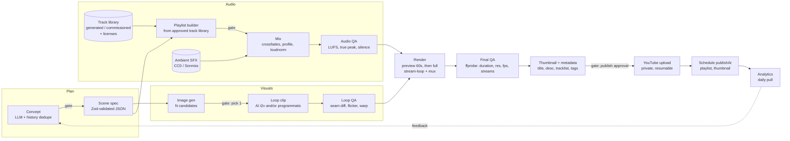

# Ambiance Channel — Phase 1: Architecture & Feasibility

Status: **draft for review** · Written 2026-10-12 · No application code yet.

Price tags used throughout:
- **[verified]** — read on the vendor's official page on 2026-10-12.
- **[search]** — from search summaries, because the vendor page blocked fetching. Likely right, but re-check before paying.
- **[est]** — my estimate.

---

## 0. TL;DR — what changed my mind while researching

1. **"Licensed royalty-free music for the MVP" doesn't work for this format.**
   - Epidemic Sound, Artlist, Soundstripe and Musicbed all ban this use in writing: music-focused videos, compilations, playlists, "music listening experiences", and still or minimally animated visuals. [verified]
   - Soundstripe's clause names "still image(s), panning motions or other limited animation" almost word for word.
   - On top of that, YouTube's reused-content policy says "Collections of songs from different artists (even if you have their permission)" can't be monetized. [verified]
   - **Recommendation:** treat the channel as one "house artist." Use music you generate (AI with commercial API rights) or commission (an exclusive buyout from a human producer), then curate it by ear.
2. **Monetization is the real risk, not the engineering.**
   - YouTube's "inauthentic content" policy (renamed July 2025, reorganized July 2026) targets "AI-generated content made with generic or unoriginal templates giving the impression of mass production." [verified]
   - A daily, templated, AI-made loop channel is near the center of that target.
   - The design has to produce real variety and visible curation, not just cheap volume.
3. **The Partner Program bar doubles on Feb 1, 2027** for new applicants: 1,000 subscribers plus 8,000 watch hours, up from 4,000. [verified]
   - Getting to 4,000 hours from zero in about 3.5 months is unlikely.
   - Plan for 8,000 and don't rush quality to beat the date.
4. **The engineering is cheap and very doable.**
   - AI spend is about $1–8 per video.
   - FFmpeg can loop a short seamless clip to 2 hours by stream-copying it (no re-encode) in about a minute.
   - YouTube upload quota is no longer a constraint: since 2025-12 an upload costs one call from a separate 100-per-day bucket. [verified]

---

## 1. Repository inspection

- `C:\Users\achandra\source\repos` holds work repos (apartments-*, ol-*, etc.) and personal projects (project-workbench, tour-guide, commute-tracker, spotted…).
- **Nothing related to ambiance or video exists**, so this is greenfield.
- Proposed location: `source\repos\ambiance-channel` (this folder).
- Machine: Node v24.15.0 is installed. **FFmpeg is not installed**; it's needed before Phase 2.

---

## 1b. Theme & art direction: India (decided 2026-10-12)

The channel's theme is **Indian ambiance**, drawn in an **illustrated** style (painterly, gouache, or anime-adjacent; not photoreal). Japan was only ever a starting idea.

### Starting scene library (rotated and varied, not permanent)
- Monsoon evening in a Mumbai apartment: rain-streaked window, blurred yellow-black taxis, a steaming cup of chai.
- A roadside chai stall under a tarp in heavy rain, kettle steaming, string lights.
- Varanasi ghats at dawn: mist on the Ganga, floating diyas, distant temple bells.
- A Kerala backwaters houseboat in monsoon rain, coconut palms swaying.
- A Himalayan cottage (Shimla or Manali) with snowfall and a wood stove.
- A Rajasthani haveli courtyard at night: lanterns, jharokha windows, a starry desert sky.
- An old Kolkata bookshop on College Street during a thunderstorm.
- A Darjeeling tea estate in drifting mist; the Nilgiri toy train passing through the hills at dusk.
- A rooftop on Diwali night: diyas flickering, distant fireworks.

### Music direction: "house artist," Indian-instrumental
Two sub-styles. The experiment checks which one the AI generators handle well:
1. **Indian lo-fi:** a soft lo-fi beat with sitar, bansuri (bamboo flute), santoor, tabla and a tanpura drone.
2. **Classical-ambient:** no beat. Tanpura drone plus slow bansuri, sitar or sarangi phrases. Suited to sleep and meditation.

**Time-of-day hook:** Hindustani ragas (melodic frameworks) are traditionally tied to times of day and seasons. A few examples:
- Bhairav: dawn.
- Yaman: evening.
- Darbari: late night.
- Megh and Miyan ki Malhar: monsoon.

This gives each scene a coherent musical mood. It's a real point of difference from generic lo-fi.

- **Honesty rule:** AI output won't reliably follow a raga's grammar, so metadata says "raga-inspired" or "evening mood." It never claims "Raag Yaman" unless a knowledgeable listener (you) confirms it.
- **Copyright:** ragas and traditional compositions aren't copyrightable. Specific recordings and film songs are. [est: general copyright principle]

### Theme-specific rules the pipeline enforces
- **No Bollywood or film music, ever,** not even as a prompt reference ("in the style of [film song or artist]"). Indian film labels are among the most aggressive Content ID claimants. [est]
- **Religious imagery is handled respectfully.** Temples, diyas, ghats and bells are fine as atmosphere. No deities as decoration, no sacred objects in careless contexts.
- **No signage text.** Image models render Devanagari and other Indic scripts as gibberish, so prompts forbid visible text, and image review checks for it.
- **Avoid stereotype shorthand,** such as generic "exotic India" haze or snake charmers. The concept generator's art-direction presets bake this in.

### Business tradeoff worth knowing
- An audience mostly *inside* India earns much lower ad revenue per view than a US or European audience. Expect several times less. [est]
- Titles and descriptions are written in English and aimed at a global audience as well as the Indian diaspora.
- The niche for *original* Indian-instrumental ambiance looks less crowded than Japanese lo-fi. Most "Indian lofi" on YouTube is remixed film songs, which this channel can't and won't do. [est]

---

## 2. Proposed MVP architecture

**A single TypeScript modular monolith.** That's one Node process with three entry points:

- **CLI** (Phases 2–4): run any stage by hand, e.g. `ambiance image generate --episode 12`.
- **Worker:** polls a job table in SQLite and runs stages.
- **HTTP API + dashboard** (Phase 5): Fastify plus a small React (Vite) single-page app.

There's no Redis, no queue service and no containers to begin with. Each part is replaceable later without a rewrite.

### Key decisions (all reversible unless marked ⚠)

| Concern | Choice | Why |
|---|---|---|
| Language | TypeScript, strict, Node 24 | Your preference; good FFmpeg/HTTP ecosystem |
| DB | SQLite (better-sqlite3) + Drizzle ORM | One file, transactional, easy backup; Drizzle migrates to Postgres if needed |
| Jobs | **DB-backed job table** with leases, attempts, idempotency keys | Durable and resumable without extra infrastructure. One worker is plenty at 1 video/day. |
| Validation | Zod for every schema: LLM output, provider responses, config | Validate everything external, as you asked |
| Assets | Content-addressed files (`data/assets/ab/abcd….png`, named by SHA-256) behind a `BlobStore` interface | Local now; Cloudflare R2 later ($0.015/GB-mo, free egress [verified]) |
| Rendering | FFmpeg / ffprobe via `child_process.spawn`, progress parsed from `-progress pipe:1` | Production-grade. Streams to disk, nothing large held in memory. |
| Audio QA | FFmpeg `ebur128`, `astats`, `silencedetect`, `loudnorm` (two-pass) | No extra native dependencies; tempo detection is optional later |
| Logging | pino (JSON) with `episodeId` / `jobId` / `stage` on every line | Structured, cheap |
| Secrets | `.env` (gitignored) locally; host secret store later; OAuth refresh token encrypted at rest | Never committed |
| Dashboard auth | Single user: password + signed session cookie, bound to localhost/Tailscale until hosted | "Simple but secure" |
| Hosting (later) | Same process on a small VM, or keep rendering local and only host the dashboard | Decide at Phase 6, not now |

### Pipeline stages = a state machine per episode

Every episode (one video) moves through stages. Each stage:

- has a status of `pending → running → succeeded | failed | awaiting_approval | skipped`;
- writes its outputs as immutable assets with full provenance;
- is **idempotent**: rerunning with the same inputs returns the cached result instead of paying again;
- can be **overridden by hand**: upload your own image or tracklist and the stage is marked `manual`.

Approval gates sit between stages. In development every gate is "require approval." Later, individual gates can be set to auto-approve once quality checks pass.

---

## 3. Production pipeline diagram



Track library curation runs as its own loop, not per episode:
**generate or import candidates → automated audio QA → you listen and approve or reject → approved library**.
Episodes only draw from approved tracks. That stops music generation from blocking the daily run, and it's where your taste goes in.

---

## 4. Providers — recommendations & alternatives

Everything sits behind interfaces: `TextGen`, `ImageGen`, `VideoGen`, `MusicGen`, `Publisher`. Each has a deterministic **mock** implementation, so the full pipeline runs in tests and dev without spending money.

### Concept & metadata (LLM)
- **Primary:** Claude Sonnet 5.5 (`claude-sonnet-5-5`). $2 / $10 per million input/output tokens [verified]. About $0.08 per concept.
- **Cheap tier:** Claude Haiku 5.5 for tags, descriptions and dedupe checks, about $0.004 per call [verified].
- **Dedupe:** compare each new concept against history using a structured "concept fingerprint" (setting, weather, time, palette, music style) plus a text-embedding similarity threshold. Reject or regenerate anything too close to the last ~60 episodes.

### Image
- **Primary:** Google `gemini-nano-banana-2.1` at 2K 16:9.
  - $0.05 per image, $0.025 batched; $0.113 at 4K [verified].
  - Native 16:9, no visible watermark (an invisible SynthID mark only).
- **Hero / fallback:** `gemini-3-pro-image` ($0.134 [verified]), BFL FLUX.2 pro/max ($0.03–0.07 [verified]), or `gpt-image-2` high (about $0.165 at 1536×1024 [verified]; 1920×1080 isn't a valid size, so use 1920×1088).
- **Not Midjourney.** It has no official API, and its terms ban automated access [search].

### Animation — two approaches, compared

| | A. AI image-to-video | B. Programmatic |
|---|---|---|
| Tool | **Veo 3.1 Fast** with `image` and `lastFrame` set to the same picture (8 s at 1080p) | FFmpeg filters + generated particle/overlay layers + masks |
| Cost | $0.96/clip on the Gemini API, which forces audio on; you strip it [verified]. Lite tier about $0.64. Fallback **Kling 3.0 Pro** with `end_image_url` set to the start image, $0.112/s with audio off [verified via fal]. | ~$0 |
| Quality | Best for organic motion: steam, rain on glass, flame | Great for rain streaks, snow, flicker, neon pulse; weak for steam and organic motion |
| Control | Low: prompt and pray, 2–4 attempts typical | Total, deterministic |
| Looping | Same first/last frame helps, but can give near-frozen motion; may still need a 0.5–1 s crossfade | **Mathematically perfect** if every effect is periodic over the loop length |
| Risks | Warping, objects morphing, unwanted camera drift | Looks "cheap" if overdone; needs masks (window regions) |

**Recommendation: a hybrid, decided by the Phase 2 experiment.**
1. Generate the base motion with Veo.
2. Layer programmatic effects that loop perfectly on top (rain particles, flicker, lightning flashes at random-but-seeded intervals).

The overlays add variety over a long runtime and hide the AI clip's seam. **Don't pick a provider yet.** Phase 2 renders the same scene three ways (Veo, Kling, programmatic only) for about $3 total.

Looping rules the code will enforce:
- **Never use ping-pong reversal.** Reversed rain falls upward.
- Seam check: compare the last frame and first frame (SSIM/PSNR via FFmpeg). Above the threshold, apply a crossfade.
- **Lightning and other "events" go in the long render's timeline, not the loop.** Otherwise a viewer notices the same strike every 8 seconds.

Watch out: fal's Veo first/last-frame endpoint is deprecated on 2026-10-22 [verified]. Call Google's API directly.

### Music — see §5. Candidate generators:
- **Google Lyria 3.5 (Gemini API):** $0.08 per full song, $0.04 per 30 s clip; SynthID on every output [verified]. Output-ownership terms still need a read.
- **ElevenLabs Music API:** real API; instrumentals 3 s–5 min [verified]. You keep the output, and online commercial use is allowed [verified]. ⚠ **§4.2 bans using output to build a "Music Library … made available to third parties"** [verified]. A channel of compilations could be read that way, so get written clarification before relying on it. Subscription pricing is [search].
- **Stable Audio 2.5/3.0:** API, trained on licensed data, 3–6 min tracks [search].
- **AIVA Pro:** you own the copyright; strong for piano; **no API**, so manual only [search].
- **Disqualified:**
  - **Suno:** no public API; download caps of 20–60 a month after the Warner settlement [search].
  - **Udio:** no downloads, and posting to YouTube is barred [search].
  - **Mubert:** Mubert keeps ownership of the tracks [search].
  - **Loudly:** the license only lasts while you're subscribed [search].

### Ambient sound
- Freesound **CC0 only.** CC-BY is OK if credited; CC-BY-NC is never usable [verified].
- **Sonniss GDC bundles:** free, commercial use, no attribution [verified].
- **Pixabay** [verified].
- ElevenLabs sound-effects generation (with a `loop` option) as a fallback [search].
- Sound effects and soundbeds aren't eligible for Content ID, so claim risk is low [verified].

### Publishing
- **YouTube Data API v3**, resumable upload, `status.privacyStatus=private` plus `status.publishAt`.
- Set `status.containsSyntheticMedia` when needed (§7).
- `thumbnails.set` (50 MB cap since 2026-09-14 [verified]).
- `playlistItems.insert`.
- Daily quota use is about 100 units against 10,000, plus 1 of the 100 daily uploads [verified].

---

## 5. Music licensing & curation strategy

### What I recommend

**The channel is one artist.** Its music is either:
1. **AI-generated through an API with clear commercial terms** (Lyria / ElevenLabs / Stable Audio), curated by you; or
2. **Commissioned from a human lo-fi producer as an exclusive buyout** of, say, 30–50 tracks. Price varies widely; roughly $30–150 per track [est]. You'd own or exclusively license it, which also makes you eligible for Content ID protection.

My suggestion is to **start with (1) for the prototype**. If AI music proves fatiguing over an hour, add (2) as the core of the library.

**Why this beats library licensing:**
- Library licenses explicitly exclude this format.
- Even a valid license doesn't protect against YouTube's "collection of songs" rule.

**Why AI alone is a risk:**
- AI music that's the main focus of a video **needs the synthetic-content disclosure** [verified]. That doesn't hurt reach or monetization [verified].
- Reviewers judging "inauthentic content" look at the channel as a whole. Varied, well-sequenced, clearly curated sets with consistent art direction are the defense.

### Composition vs recording rights
These are always tracked separately in the data model. A Chopin nocturne (composition in the public domain) performed by an AI or a commissioned pianist is fine. A 2015 recording of it is not.

Public-domain *recordings* are mostly pre-1926 audio, which is lo-fi in the bad sense, and anyone can re-upload them [verified MMA timeline]. Useful as a source of melodies, not as finished audio.

### Library mechanics
Each **Track** stores:
- source, provider and model, prompt/seed;
- **license record**: terms URL, a snapshot of the terms text with its date, plan tier at generation time, proof (invoice/PDF);
- duration, estimated tempo, key (optional), mood, instruments, energy 1–5;
- audio QA results;
- approval status and who approved it;
- usage history.

**Automated QA** (FFmpeg) rejects a track when any of these is true:
- true peak > −1 dBTP after normalization;
- a clipping run is detected;
- silence > 2 s mid-track;
- loudness range is extreme;
- duration is outside 90 s–6 min.

**Your review:** a dashboard page (a CLI plus an HTML listening page in Phase 3) where you play candidates and approve or reject them. The experiment will tell us how long this takes you.

**Playlist builder:**
- Fills the target duration from approved tracks matching the concept's mood and energy curve.
- Never reuses a track within one video.
- Caps reuse across videos: each track appears at most N times overall, never in consecutive episodes.
- Sequences by tempo and key adjacency.
- Uses 3–6 s equal-power crossfades.
- Writes a tracklist with timestamps for the description.

### Mixing
- Profiles: `music_forward` (music 0 dB, ambience −18 dB), `balanced`, `ambient_forward`.
- Two-pass `loudnorm` to **−16 LUFS integrated, −1.5 dBTP** [est]. YouTube turns loud audio down to about −14 anyway, and a bit quieter suits sleep and study.
- Ambient beds are crossfade-looped and length-randomized, so the seams don't line up.

---

## 6. Cost estimates

Assumes a 90-minute video and per-video variable costs only. LLM, image, Veo and Lyria unit prices are **[verified]**; the usage counts are **[est]**.

| Item | Lean | Typical | Ceiling |
|---|---|---|---|
| Concept + metadata (Sonnet 5.5) | $0.10 | $0.15 | $0.30 |
| Images (4–8 × $0.05 at 2K, final at 4K $0.11) | $0.20 | $0.45 | $1.00 |
| Loop animation | $0 (programmatic) | $2.00 (≈2 Veo Fast tries) | $4.00 |
| Music (Lyria $0.08/song; 90 min ≈ 36 songs; 2× over-generation to curate) | $1.00 (library reuse) | $5.80 | $8.00 |
| Ambient SFX | $0 (CC0/Sonniss, one-time) | $0 | $0.50 |
| Render | $0 (local) | $0 | $0.10 (cloud spot) |
| Storage (≈5 GB master, kept 30 days on R2) | $0 (delete after upload) | $0.08 | $0.08 |
| **Per video** | **≈ $1.30** | **≈ $8.50** | **≈ $14** |
| **30 videos / month (variable)** | **≈ $40** | **≈ $255** | **≈ $420** |

**Fixed monthly costs:**
- Local development: $0.
- Optional ElevenLabs subscription: $22–99/mo [search].
- A hosted VM later: €5–35/mo [search; Hetzner raised prices in 2026-06].
- Domain: optional, about $1/mo.

**How "typical" comes down quickly:**
- Music is the big lever. A good library built over the first month can be reused within limits, which takes music to about $1–2 per video.
- With a hybrid where Veo succeeds on the first try, typical is about **$3–4 per video, ≈ $100/mo** [est].

**Not counted: your time.** Expect 30–60 min a day reviewing at first. Bringing that down is what Phases 5–6 are for.

**Cost controls (built in from day one):**
- Every paid call goes through a `CostGuard` with a per-call estimate.
- Daily and monthly caps.
- A "needs approval above $X" threshold.
- A ledger row for every charge.
- `PAID_PROVIDERS=off` by default in development, so mocks run unless you opt in.

---

## 7. YouTube monetization & copyright risks

| # | Risk | Likelihood | Mitigation |
|---|---|---|---|
| 1 | **Rejected for "inauthentic content"** at Partner Program review (templated, mass-produced look) | High if we're careless | Real variety in scene, palette, motion and music. Named series. Hand-written or edited descriptions with scene notes and tracklists. Start at **3–4 videos/week, not 7** until reviewed. Never publish near-duplicates (the dedupe gate). |
| 2 | **"Reused content"** because the music is someone else's | High with stock libraries | House-artist music only (§5). No library compilations. |
| 3 | **Content ID claim** redirects a whole 2-hour video's revenue | Medium | Avoid libraries that register their tracks. Keep license proof per track. Dispute within 5 days so revenue is held, not lost [verified]. Commissioned exclusive music can be registered by *you*. |
| 4 | **Missing synthetic-content disclosure** | Low if handled | Set `containsSyntheticMedia=true` whenever AI music is the main focus, or visuals are photoreal [verified rules]. Stylized/anime visuals don't need it, but AI music does, so in practice we'll set it on most videos. Disclosure doesn't reduce reach [verified]. |
| 5 | **Partner Program bar doubles 2027-02-01** | Certain | Plan for 1,000 subs + 8,000 hours. Long videos accrue hours quickly once anyone watches. |
| 6 | **Upload lock / token expiry** | Medium | Docs now say unverified API projects aren't locked to private, but the pages contradict each other [verified]. Test on day one. Put the OAuth consent screen "In production" (testing-mode tokens die in 7 days [verified]). Phone-verify the channel: needed for >15 min uploads and custom thumbnails [verified]. |
| 6b | **Film-music Content ID / cultural missteps** (India theme) | Medium | No film-song references in any prompt. Respectful religious imagery. Review gate on every image (§1b). |
| 7 | **Provider terms change** (music especially) | Medium | Snapshot the terms text per track at generation time. Provenance ledger. Provider interfaces make switching cheap. |

Honest take: this is a crowded niche. Lofi Girl, Chillhop and many AI channels already exist. The thing that's yours is **taste**: curated music and coherent art direction. The system should spend money and effort there, not on volume.

---

## 8. Data model (initial)

```
Episode        id, slug, status, currentStage, concept_id, scheduled_for, paused, created_at
Concept        id, source(ai|manual), spec_json (Zod: SceneSpec), fingerprint_json, embedding, status
StageRun       id, episode_id, stage, status, attempt, input_hash, output_asset_ids, error, started/finished
Job            id, type, payload_json, idempotency_key UNIQUE, status, run_after, lease_until, attempts, last_error
Asset          id, sha256 UNIQUE, kind(image|clip|audio|video|thumbnail|license_doc), path, bytes,
               width/height/duration, provenance_json, parent_asset_ids
GenerationRun  id, provider, model, prompt, params_json, cost_usd_est, cost_usd_actual, asset_id, status, raw_response_ref
Track          id, asset_id, title, source(ai|commissioned|pd|manual), license_id, tempo, key, mood[], instruments[],
               energy, qa_json, approval(pending|approved|rejected), approved_at, use_count, last_used_episode
License        id, provider, plan_tier, terms_url, terms_snapshot_asset_id, proof_asset_id, rights_json
               (commercial, youtube_monetize, attribution, composition_owner, recording_owner)
AmbientSound   id, asset_id, license_id, kind(rain|thunder|cafe|train|fire|wind|city), loopable
MixProfile     id, name, music_gain_db, ambience_gain_db, target_lufs, true_peak
Playlist       id, episode_id, items[{track_id, start_s, crossfade_s}]
Render         id, episode_id, kind(preview|full), params_json, asset_id, ffprobe_json, qa_json
Upload         id, episode_id, youtube_video_id UNIQUE, status, privacy, publish_at, upload_session_uri, metadata_json
CostLedger     id, at, provider, op, usd, episode_id, generation_run_id
Setting        key, value   (global_pause, daily_budget_usd, monthly_budget_usd, approval_gates_json, schedule_cron)
AnalyticsDaily video_id, date, views, engaged_views, watch_minutes, avg_view_duration, impressions, ctr, subs_gained
```

**Duplicate-upload protection:**
- An `Upload` row is created *before* the API call, with the episode ID as the idempotency key.
- A resumed upload reuses `upload_session_uri`.
- `youtube_video_id` is unique.
- A pre-flight `videos.list` checks for an existing video with our episode tag in the description.

### Core interfaces (sketch, not final code)

```ts
interface ImageGen { generate(req: ImageRequest): Promise<GenerationResult<ImageAsset>>; estimateCost(req): Money }
interface VideoGen { imageToVideo(req: I2VRequest /* start, end?, seconds, prompt */): Promise<GenerationResult<ClipAsset>>; estimateCost(req): Money }
interface MusicGen { generate(req: MusicRequest /* prompt, seconds, instrumental */): Promise<GenerationResult<AudioAsset>>; estimateCost(req): Money; licenseFor(run): LicenseRecord }
interface TextGen  { structured<T>(schema: ZodType<T>, prompt: Prompt): Promise<GenerationResult<T>> }
interface Publisher { upload(v: UploadRequest, onProgress): Promise<UploadResult>; setThumbnail(...); schedule(...); status(id) }
```

Long-running provider jobs (Veo is asynchronous) are stored as `GenerationRun` with the provider's operation ID, so a crash mid-poll resumes polling instead of paying again.

---

## 9. Proposed repository structure

```
ambiance-channel/
  docs/                 ARCHITECTURE.md, SETUP.md, decisions/ (short ADRs)
  src/
    core/               config (zod-env), db (drizzle schema + migrations), jobs (queue, worker, leases),
                        assets (BlobStore, hashing), cost (CostGuard, ledger), log, ffmpeg (spawn + progress + ffprobe)
    modules/
      concepts/         schema (SceneSpec), generator, dedupe
      images/           pipeline, prompt builder (art-direction presets)
      animation/        i2v stage, programmatic layers, loop builder, seam QA
      music/            library, import, audio QA, playlist builder
      audio/            mixer, profiles, ambient bed looper
      render/           preview + full render, final QA
      metadata/         title/description/tags/thumbnail
      publishing/       youtube oauth, resumable upload, scheduling
      scheduling/       daily planner, pause/resume
      analytics/        youtube analytics + reporting api pulls
    providers/          anthropic/, gemini/ (image, veo, lyria), kling/, elevenlabs/, mock/
    cli/                commander-based CLI entry
    server/             fastify API (Phase 5)
  dashboard/            vite + react (Phase 5)
  presets/              art-direction & mix-profile presets (JSON, versioned)
  test/                 vitest; fixtures (tiny images/audio), mock providers
  data/                 GITIGNORED: sqlite db, assets, renders
  .env.example
```

---

## 10. Implementation plan with acceptance criteria

**Phase 2a — Taste test (manual, about one evening, under $10).** See §11. Gate: you'd genuinely watch it.

**Phase 2b — Prototype tooling (CLI only)**
- Project skeleton, config, SQLite, asset store, CostGuard, logging, FFmpeg wrapper, mock providers.
- Commands: `image generate|import`, `clip generate|import|programmatic`, `track import|generate`, `track qa`, `mix`, `render --preview|--minutes 10`.
- ✅ **Acceptance:**
  - A 10-min 1080p MP4 is produced from one command chain.
  - ffprobe validation passes.
  - The audio QA report shows −16 ±1 LUFS and peaks ≤ −1.5 dBTP.
  - Every asset has a provenance row.
  - Tests pass with mock providers and no network.

**Phase 3 — Full-length pipeline**
- SceneSpec generation and dedupe, image candidates plus approval, loop QA, playlist builder, 60–120 min render, thumbnail and metadata, cost ledger per episode.
- Resumable: kill the process mid-render and rerun it; completed stages aren't redone and nothing is paid for twice.
- ✅ **Acceptance:**
  - One 90-min video ready for manual upload, plus a metadata JSON and a tracklist.
  - A full render takes ≤ 15 min locally.
  - Peak RAM stays under 1 GB.

**Phase 4 — YouTube integration**
- OAuth (consent screen in production, encrypted refresh token), resumable chunked upload with retry and resume, private upload, `publishAt`, thumbnail, playlist, synthetic flag, processing-status polling, duplicate protection.
- ✅ **Acceptance:**
  - A private upload survives a killed process mid-upload and resumes.
  - Running it twice creates no duplicate.
  - Nothing goes public without an explicit `--approve-public`.

**Phase 5 — Dashboard & scheduling**
- Fastify API plus React pages: queue, episode detail (images, previews, players), track review, failed jobs and retry, costs, global pause, publish approval, schedule config.
- ✅ **Acceptance:** a full episode is supervised end to end from the browser, and pause stops new work within one job.

**Phase 6 — Autonomous operation**
- Daily planner, auto-approve per gate when QA passes, budget enforcement, notifications on failure and on items awaiting approval (email or a push service), hosted deployment.
- ✅ **Acceptance:** 14 consecutive days of supervised-auto runs, under the cost cap, with zero duplicate or unapproved public posts.

**Phase 7 — Analytics & optimization**
- Analytics API (views, watch time, average view duration), Reporting API reach reports (impressions and click-through rate live only there [verified]), performance by theme, duration and music style, concept-generator feedback weighting, a Partner Program readiness check.
- ✅ **Acceptance:** a weekly report, and the concept generator's choices visibly shift toward what performs.

---

## 11. Smallest experiment to validate the concept (Phase 2a)

**Goal:** answer "would I actually leave this on?" before building the system. Mostly by hand, with a few throwaway FFmpeg commands. **Budget cap: $10.**

1. **One scene:** "Monsoon evening in a small Mumbai apartment, desk by a tall window, rain streaming down the glass, blurred yellow-black taxis and street lights below, warm lamp, a steaming cup of chai." Illustrated, painterly style, with no visible text.
2. **Image:** 6 candidates with `gemini-nano-banana-2.1` at 2K (about $0.30). You pick one.
3. **Animation, three variants of the same image:**
   - (a) Veo 3.1 Fast with first = last frame, 8 s (about $1–2 with one retry).
   - (b) Kling 3.0 Pro with end image = start, 10 s, audio off (about $1.12).
   - (c) Programmatic only: rain streak layer + lamp flicker + window glow, $0.
4. **Music:** about 25 Lyria tracks ($2), split across both sub-styles: Indian lo-fi (sitar, bansuri, tabla, beat) and classical-ambient (tanpura drone, bansuri, no beat). You approve the 4–5 best (≈ 12 min). **This is now the riskiest question:** can AI generators produce Indian instruments that sound authentic rather than like a cheap sample pack?
5. **Ambience:** one CC0 monsoon-rain bed from Freesound/Sonniss (rain on a window or a tin roof), optionally with distant traffic.
6. **Render:** three 10-min MP4s, one per animation variant, same audio.
7. **The test:** play them while you work. Write down:
   - which loop you noticed;
   - whether the music fatigued you;
   - how long the music review took;
   - whether you'd want to come back to it.

**Decisions this experiment settles:**
- AI music viable? (yes / commission humans / both)
- Animation approach (A / B / hybrid)
- Art direction baseline
- Whether review time is sustainable

---

## 12. Decisions (resolved 2026-10-12)

1. **Music source:** AI-generated house artist to start. Commissioning a human producer stays the fallback if AI Indian instrumentation falls short.
2. **Cadence:** 3–4 videos/week at launch, or fewer if quality needs it. A config value, not hardcoded.
3. **Visual style:** illustrated. No synthetic-content label needed for the visuals; AI music still gets one.
4. **Theme:** Indian ambiance (§1b), replacing the Japanese starting themes.
5. **Experiment spend:** approved up to $10 for Phase 2a.
